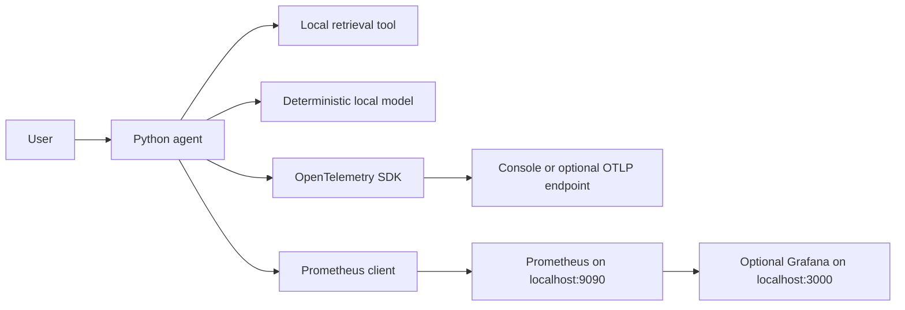

# Agent Observability & Incident Response System

A deterministic Python agent with OpenTelemetry traces, Prometheus metrics and alerts, a Grafana dashboard, and an incident-response runbook. The application and monitoring tools run as separate native processes on Windows; no container runtime is required.

## Architecture



## Prerequisites

- Windows PowerShell
- Python 3.11 or newer
- Prometheus Windows executable (included at `prometheus\prometheus\prometheus.exe`)
- Optional: Grafana Windows ZIP distribution, extracted to a folder of your choice

The Prometheus directory also contains `promtool.exe` for validating Prometheus configuration and alert rules. If you use another Prometheus build, set the executable variables below to its extracted location; do not rely on a global `PATH` entry.

## Install Python dependencies

In PowerShell, from the project directory:

```powershell
.\venv\Scripts\Activate.ps1
python -m pip install -r requirements.txt
```

If PowerShell does not allow activation scripts, use the virtual environment's Python executable directly:

```powershell
.\venv\Scripts\python.exe -m pip install -r requirements.txt
```

## One-command startup

Open PowerShell in the project folder and run:

```powershell
.\start_project.ps1
```

The script starts the agent and the bundled Windows Prometheus executable, waits for the agent health endpoint, confirms the Prometheus scrape target is UP, and checks that all three alert rules are loaded. It opens the Prometheus targets page. Logs are written to `logs\agent.log`, `logs\agent-error.log`, `logs\prometheus.log`, and `logs\prometheus-error.log`.

The startup script uses Python from `venv\Scripts\python.exe`, Prometheus from `prometheus\prometheus\prometheus.exe`, and the existing Prometheus data directory. It checks ports before starting services. If a port is occupied by a process that does not provide the expected service, the script reports the PID and exits without terminating that process.

The agent runs a deterministic tool-failure sample on startup, so the tool-failure counter should have a numeric sample. It serves:

- Health JSON at [http://localhost:8000/health](http://localhost:8000/health)
- Prometheus metrics at [http://localhost:8000/metrics](http://localhost:8000/metrics)
- Prometheus web interface at [http://localhost:9090](http://localhost:9090)
- Prometheus scrape target status at [http://localhost:9090/targets](http://localhost:9090/targets)
- Prometheus alerts page at [http://localhost:9090/alerts](http://localhost:9090/alerts)

To inspect the live tool-failure counter from PowerShell:

```powershell
(Invoke-WebRequest -UseBasicParsing http://localhost:8000/metrics).Content |
    Select-String '^agent_tool_failures_total'
```

The sample line includes labels and a numeric value (for example, `1.0`); it is not just the HELP/TYPE metadata.

To query request counts in Prometheus, enter `agent_requests_total` in the expression field.

## Stop the project

Run:

```powershell
.\stop_project.ps1
```

The stop script only stops processes recorded by `start_project.ps1`, and checks each process's executable and command line before stopping it. It leaves unrelated processes, Prometheus data, and log files untouched.

The default local implementation does not need external LLM credentials. Traces are written to the console by default; setting `OTEL_EXPORTER_OTLP_ENDPOINT` optionally sends them to an OTLP/HTTP collector.

## Start Prometheus on Windows

With the Python agent still running, open a second PowerShell terminal in the project directory (Terminal 2). The following uses the executable shipped in this workspace and explicitly points to the project configuration and local data directory:

```powershell
$projectRoot = (Get-Location).Path
$prometheusExe = Join-Path $projectRoot 'prometheus\prometheus\prometheus.exe'
$prometheusConfig = Join-Path $projectRoot 'prometheus\prometheus\prometheus.yml'
$prometheusData = Join-Path $projectRoot 'prometheus\data'

if (-not (Test-Path $prometheusExe)) {
    throw "Prometheus executable not found: $prometheusExe"
}

& $prometheusExe "--config.file=$prometheusConfig" "--storage.tsdb.path=$prometheusData"
```

If Prometheus is extracted elsewhere, set `$prometheusExe` to that `prometheus.exe` and keep `$prometheusConfig` pointed at this project's `prometheus\prometheus\prometheus.yml`. Its scrape target is `localhost:8000`, its scrape and evaluation intervals are 5 seconds, and it loads the rules from `docs\alerts.yml`.

Open the Prometheus web interface at [http://localhost:9090](http://localhost:9090), then verify the `agent-observability` target is **UP** at [http://localhost:9090/targets](http://localhost:9090/targets). In the Prometheus query page, enter:

```promql
agent_requests_total
```

Run the agent before querying so the request counter has sample data. Metrics are exposed from the Python process at `http://localhost:8000/metrics`.

## Run Grafana separately (optional)

Grafana is optional and independent; the Python agent and Prometheus work without it. Download the Windows ZIP distribution from the official Grafana downloads page and extract it. In a new PowerShell window, set `$grafanaHome` to the extracted directory and start the server:

```powershell
$grafanaHome = 'C:\tools\grafana' # Change this to the directory where you extracted Grafana.
$grafanaServer = Join-Path $grafanaHome 'bin\grafana-server.exe'

if (-not (Test-Path $grafanaServer)) {
    throw "Grafana executable not found: $grafanaServer"
}

& $grafanaServer "--homepath=$grafanaHome"
```

Open [http://localhost:3000](http://localhost:3000) and complete Grafana's initial setup. Add a Prometheus data source with URL `http://localhost:9090`, or use the included provisioning file at `grafana\provisioning\datasources\prometheus.yml` by copying it to the extracted Grafana installation's `conf\provisioning\datasources` directory and restarting Grafana. Import `grafana\dashboards\agent-observability-dashboard.json` through **Dashboards > New > Import** and select the Prometheus data source.

The dashboard uses metrics emitted by the agent, including request volume, error rate, p95 latency, execution duration, token usage, and estimated token cost. The deterministic local mock reports estimated token counts for demonstration and no paid model cost.

## Alerts and runbook

Prometheus loads and displays these rules on [http://localhost:9090/alerts](http://localhost:9090/alerts):

- `AgentHighErrorRate`: request error rate exceeds 5% over the 5-minute rate window continuously for 2 minutes.
- `AgentHighLatency`: p95 request latency exceeds 2 seconds over the 5-minute window continuously for 2 minutes.
- `AgentToolFailureSpike`: more than 3 tool failures occur in a rolling 5-minute window continuously for 2 minutes.

To safely verify rule evaluation and firing without injecting traffic into the live service, run the Prometheus rule test fixture:

```powershell
.\prometheus\prometheus\promtool.exe test rules .\tests\prometheus_alerts.test.yml
```

The fixture supplies synthetic time series to the actual `docs\alerts.yml` rules; a successful test confirms all three rules fire under the configured conditions. This does not create live alerts in the running Prometheus server and does not send notifications. Live rules need the configured condition to persist for their evaluation window and `for` duration; check their state at `/alerts`.

### Latest verified status (2026-10-24)

- Full Python test suite: **13 passed**.
- Prometheus agent target: **UP** at `http://localhost:8000/metrics`.
- Scraped `agent_tool_failures_total{status="error",tool_name="retrieval"}` sample: **1**.
- Loaded alert rules: `AgentHighErrorRate`, `AgentHighLatency`, and `AgentToolFailureSpike`.
- Live alert states: all three **INACTIVE**; the currently observed traffic does not meet the configured thresholds.
- Safe synthetic alert test: `promtool test rules` returned **SUCCESS** against the actual alert rules, verifying that all three rules fire when supplied with input series meeting their conditions. This verifies rule behavior, not a live notification or a firing alert in the running Prometheus server.

For diagnosis and recovery procedures, see [docs/runbook.md](docs/runbook.md).

## Tests and configuration validation

From the project directory:

```powershell
.\venv\Scripts\python.exe -m pytest -q
```

Validate the Prometheus configuration and alert rules with the bundled executable:

```powershell
.\prometheus\prometheus\promtool.exe check config .\prometheus\prometheus\prometheus.yml
.\prometheus\prometheus\promtool.exe check rules .\docs\alerts.yml
.\prometheus\prometheus\promtool.exe test rules .\tests\prometheus_alerts.test.yml
```

## Troubleshooting

- **Port 8000 is already in use:** check the process ID reported by `start_project.ps1`. The script will not stop an unrecognized process; stop or reconfigure that process before starting the agent.
- **Port 9090 is already in use:** check the reported process and make sure it is the Prometheus instance configured for this project. The startup script does not kill it.
- **Agent or Prometheus fails to start:** inspect the corresponding `logs\*-error.log` file.
- **Prometheus target is DOWN:** confirm the agent responds at `http://localhost:8000/health`, then refresh `/targets`. Prometheus scrapes every 5 seconds.
- **Tool failure counter has no sample:** check `logs\agent-error.log`; the startup demonstration should run `run_agent("fail this request")` and increment the counter once.
- **Alert is inactive:** ordinary startup traffic may not meet an alert threshold. Use the safe `promtool test rules` command above to verify firing, or wait until live traffic exceeds the documented threshold and `for` duration.
- **Stopping does not stop a process:** the stop script deliberately leaves a process alone if its PID, executable, or command line does not match its startup record. Inspect it manually before taking action.

## Configuration

See `.env.example` for the supported environment variable names:

- `APP_VERSION`
- `OTEL_SERVICE_NAME`
- `OTEL_EXPORTER_OTLP_ENDPOINT`
- `METRICS_PORT` (defaults to `8000`)

The agent uses console tracing and local deterministic responses by default. It does not require API keys, external services, or internet access for the regression tests.
